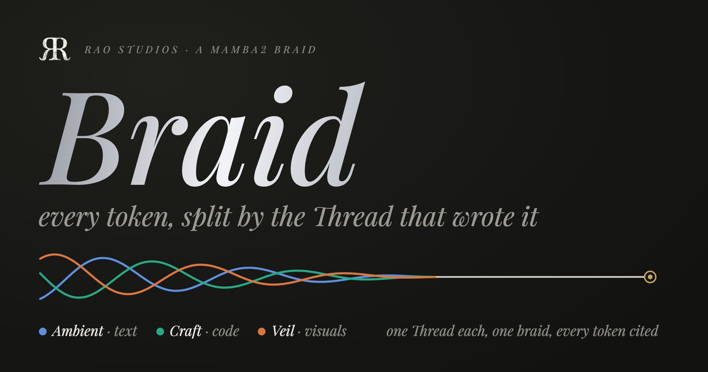

[](Docs/README_Assets/hero.png)

# Braid

Braid is a language model made of strands:
- **The commons** is a pretrained Mamba2 model.
- **Each Thread** is one corpus: its own trained blocks, plus an index of every position in its text. It runs those blocks in front of the commons' trunk, one set of frozen weights per machine, named by its seam.

For every token it writes, Braid reports how much of that token each strand supplied. These shares are exact and sum to 1. Each Thread's part is cited to its own text, which `braid verify` re-reads token for token.

![Four questions asked of one braid in the studio. "Hello there" is answered by the commons, in gold. "The article says Tillyburn was founded in" is answered "1128" by Ambient, in blue. "Health checks reach Joltvault on port" is answered "41027" by Craft, in green. "The catalogue lists the painter of Window in Autumn as" is answered "Olmira Hollismore" by Veil, in orange. As each token arrives, the token block shows who supplied it, its trace and entropies and its citation, and the Threads and Royalties panes fill with each strand's share.](Docs/README_Assets/braid.gif)

There is no attention and no KV cache. The trunk is Mamba2 (SSD), so everything a strand knows about a session is a fixed-size state, 19 MB at 130m. That state can be checkpointed, hashed and replayed. Threads come from braid datasets, folders, or lanes of the Ambient Intelligence Index (AII).

## The CLI at a glance


```sh
Scripts/cli.sh doctor                                     # checks the setup
Scripts/cli.sh init --base AntonV/mamba2-130m-hf          # imports the pack, writes braid.toml
Scripts/cli.sh thread create ambient --corpus dataset:braid-n3#ambient --limit 40
Scripts/cli.sh chat "The article says Tillyburn was founded in"
Scripts/cli.sh                                            # the studio
```

`Scripts/cli.sh` builds `braid`, installs MLX's Metal library beside it, and points the AII dependency at `../AII`. Every command, flag and key is in [Docs/CLI.md](Docs/CLI.md).

## The studio

[](Docs/README_Assets/braid-screen.png)

To see it without a model or a work area, replay the four answers above with `Scripts/cli.sh ui --fixtures Docs/README_Assets/src/fixtures`.

## Braid, step by step

A guided tour for readers new to language models and for model engineers alike: the whole machine in one picture, then eleven questions, from what entropy is and why a citation needs it to training a Thread on your own records, with figures that compute with Braid's own arithmetic and real sessions replayed token by token. Double-click `Scripts/site.command`, or open [Docs/site/index.html](Docs/site/index.html) in a browser; it is plain HTML with no build step. [Docs/site/README.md](Docs/site/README.md) says how it is rebuilt and checked.

## Requirements and tests

- Xcode 27 (Swift 6.4), macOS 26, Apple silicon.
- Frigate and AII, which SwiftPM fetches from GitHub. A sibling `../AII` checkout stands in for AII when there is one.
- A work area for data: wherever `BRAID_WORK_AREA` points, by default `/Volumes/T9/rao/projects/braid`.
- `Scripts/test.sh` runs every suite. `BRAID_MLX_TESTS=0` skips the GPU suites, and `BRAID_AII_TESTS=1` adds the live AII tests. Build tests only through this script.

| Target | Holds |
|---|---|
| BraidCore | records, hashing, the session log, the node protocol, the cluster, gate, mixer, trace, credit, the verifier, the RaoLM port |
| BraidThread | AII lanes, demo AIIs |
| BraidKit | the Mamba2 trunk and its SSD scan, packs, the index and replay, Thread training, the Thread recipes and the engine that builds them, the local node, questions, benches |
| BraidTerminal, BraidStudio | the terminal toolkit and the studio |
| BraidCLI | the `braid` executable |

Inside each target, folders follow the order of operations, and the site's [code explorer](Docs/site/code.html) walks them. [Examples/](Examples/README.md) runs the whole loop on this Mac: an AII app's records, one trained Thread, a braid, a query.

## Scripts

| Script | What it does |
|---|---|
| `Scripts/cli.sh` | Runs `braid` from this checkout. It builds when a source is newer than the binary, puts MLX's Metal library beside it, and passes every argument through. `BRAID_CONFIG=release` for anything that trains or measures; `BRAID_SKIP_BUILD=1` reuses the last build. |
| `Scripts/test.sh` | Builds the tests, gives the test bundles the Metal library, and runs them. Arguments go to `swift test`, as in `--filter BraidCoreTests`. |
| `Scripts/site.command` | Opens [Braid, step by step](Docs/site/index.html) in the default browser. Double-click it in Finder. |
| `Scripts/neox-fixture.py` | Records how Hugging Face's `tokenizers` encodes a few strings with the pack's `tokenizer.json`, so the tokenizer test checks Braid against an independent implementation. It ran once; the fixture is committed. |

The README's images are rebuilt by `Docs/README_Assets/src/build.sh`.

GNU General Public License v3.0 (see [LICENSE](LICENSE)).

> *One reed sews many threads into a braided voice.*